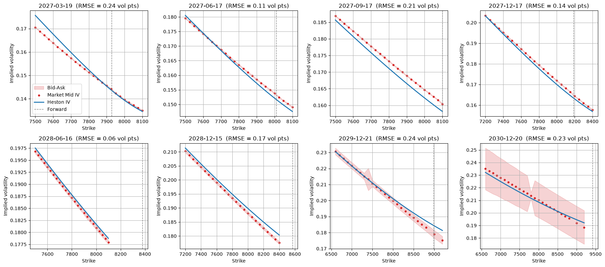
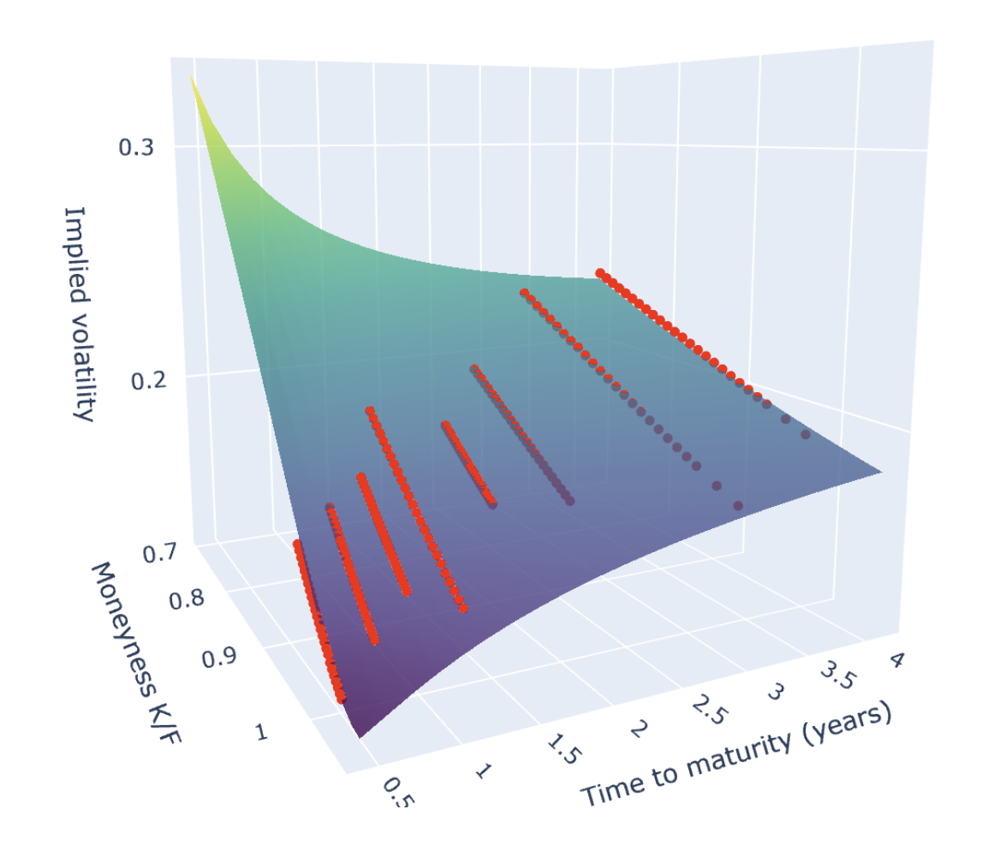
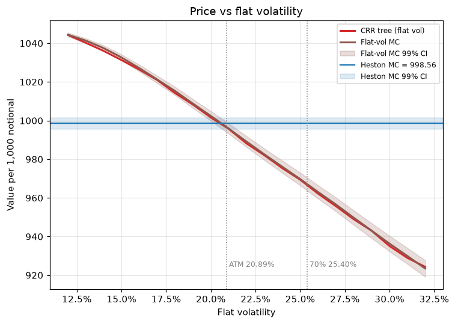
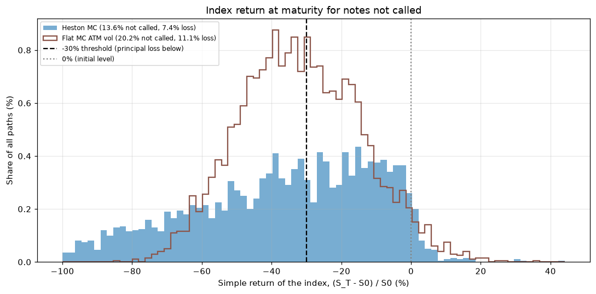

# Pricing an S&P 500 Autocallable Note with a Calibrated Heston Model

I price a Bank of America four-year autocallable contingent coupon note on the S&P 500 with a Heston
stochastic volatility model calibrated to the SPX implied volatility surface (Bloomberg), using Monte Carlo
simulation. I then test whether stochastic volatility changes the answer compared with a standard
flat-volatility model.

**Full report:** [report/Heston_Autocallable_Pricing_Report.pdf](report/Heston_Autocallable_Pricing_Report.pdf)

## Key results

- **Fair value: $998.56 per $1,000** (99% CI $995.65 to $1,001.47), 0.56% above BofA's estimated value of
  $993.00. The gap matches an issuer funding spread of **0.40%** over the SOFR OIS rate.
- **The numbers are robust:** with 20,000 paths the probability of a pricing error above $10 is at most 1.3%,
  the price is stable to the time step, and the flat-volatility Monte Carlo agrees with an independent
  binomial tree within $0.76.
- **Flat volatility gets the price but not the risk.** At the ATM volatility, a flat-vol model prices the note
  within $2 of Heston, but the outcomes behind the price are very different:

| | Heston MC | Flat-vol MC (ATM 20.89%) |
|---|---:|---:|
| Fair value | $998.56 | $996.67 |
| Called on the first call date | 67.9% | 52.4% |
| Expected life | 1.60 years | 1.88 years |
| Probability of losing principal | 7.4% | 11.1% |
| Average loss, given a loss | 55% of principal | 44% of principal |

Choosing the volatility at the 70% barrier (25.40%) instead underprices the note by about $31.

## Calibration results

The five Heston parameters are fitted to 200 SPX options across 8 expiries (Mar-2027 to Dec-2030) under three
objectives:

| Fit | v₀ | κ | θ | η | ρ | Feller ratio 2κθ/η² | RMSE (vol pts) |
|---|---:|---:|---:|---:|---:|---:|---:|
| **Regular (used)** | **0.0283** | **3.416** | **0.0547** | **1.950** | **−0.545** | **0.098** | **0.19** |
| Spread-weighted | 0.0191 | 4.203 | 0.0481 | 1.595 | −0.604 | 0.159 | 0.28 |
| Feller-penalized | 0.0146 | 1.880 | 0.0473 | 0.422 | −0.950 | 1.00 | 0.36 |

- **Economically sensible parameters:** current volatility √v₀ = 16.8% rising toward a long-run level of
  √θ = 23.4%, mean reversion κ = 3.4 (half-life about 2.5 months), and a negative spot-vol correlation that
  produces the equity skew.
- **Close fit:** the error per expiry ranges from 0.06 to 0.24 vol points.
- **Feller condition:** enforcing it nearly doubles the fit error and drives ρ to its −0.95 bound, so the
  regular fit is used. Repricing the note with the other two fits moves the price by less than $2.

<p align="center">
  
  <br><em>Heston implied volatility (blue) against market mid quotes (red) and the bid-ask band, by expiry.</em>
</p>

<p align="center">
  
  <br><em>Calibrated Heston implied volatility surface, with the market quotes in red.</em>
</p>

## Heston vs flat volatility

| Price against a single flat volatility | Index return at maturity, notes not called |
|:---:|:---:|
|  |  |

- **Left:** the flat-volatility tree and Monte Carlo agree with each other and cross the Heston price (blue band)
  at a flat volatility of 20.55%, close to the ATM level. At the 70% barrier volatility the note is about $31
  cheaper, so a flat model is only right if the right volatility is picked.
- **Right:** for notes that reach maturity, Heston (blue) puts less mass just below the −30% loss threshold but
  much more in the far left tail. The index ends below 30% of its initial level in 1.7% of Heston paths, against
  0.1% under flat volatility.

The two models also build the price from different cash flows. Heston starts from a lower current volatility
(16.8%), so the note is called earlier and pays fewer coupons:

| PV per $1,000 | Heston MC | Flat-vol MC (ATM) |
|---|---:|---:|
| Coupons | 101.7 | 118.6 |
| Principal repaid at an autocall | 817.7 | 751.2 |
| Principal repaid at maturity | 79.2 | 126.9 |
| **Total** | **998.6** | **996.7** |

## Method

1. **Market data** (Bloomberg, 12-Oct-2026 surface; rates and dividends on the 18-Sep-2026 pricing date):
   SOFR OIS rate 4.567%, OVME dividend yield 1.151%, SPX option chains and the ATM volatility term structure.
   Quotes with no bid or fewer than 10 contracts traded are removed; implied volatilities are backed out with
   Black's formula using Bloomberg forwards and discount factors from put-call parity.
2. **Calibration in three steps:** kappa and theta from the ATM variance term structure, eta and rho from the
   Dec-2026 and Mar-2027 smiles, then all five parameters on 200 options across 8 expiries
   (RMSE 0.19 vol points). Spread-weighted and Feller-penalized objectives are compared.
3. **Pricing:** Monte Carlo with 20,000 paths and daily steps (log-Euler for the index, full-truncation Euler
   for the variance), discounting each cash flow at the OIS rate.
4. **Validation:** Chebyshev error bound, 300 independent runs to check the CLT interval, a time-step check,
   and a Cox-Ross-Rubinstein binomial tree as an independent benchmark.
5. **Model comparison:** value decomposition, autocall and loss probabilities, and the loss distribution under
   Heston and flat volatility.

## Repository structure

```
├── data_preprocess.ipynb   # 1. clean quotes, discount factors, implied volatilities
├── calibration.ipynb       # 2. three-step Heston calibration and fit diagnostics
├── monte_carlo.ipynb       # 3. Heston MC price, funding spread, convergence, flat-vol benchmarks
├── comparison.ipynb        # 4. Heston vs flat volatility: decomposition, probabilities, losses
├── modules/
│   ├── preprocess.py       # data reading, cleaning, Black implied volatility
│   ├── calibration.py      # Heston pricing (characteristic function) and calibration
│   ├── monte_carlo.py      # Heston Monte Carlo pricer and convergence statistics
│   ├── binomial.py         # CRR binomial tree for the note, flat-vol surface lookup
│   ├── comparison.py       # vectorized paths, per-path cash flows, tree event probabilities
│   └── discretization.py   # time-step checks
├── figures/                # plots shown in this README
└── report/                 # final report (PDF)
```

## How to run

```bash
pip install -r requirements.txt
```

Put the data files in a `Data/` folder (see below), then run the notebooks in order 1 to 4.
Tested with Python 3.14.

## Data

The Bloomberg market data is **not included** in this repository because Bloomberg data may not be
redistributed. The notebooks expect these files in `Data/`:

| File | Content | Bloomberg source |
|---|---|---|
| `ATM_IV.xlsx` | sheet `ATMF`: ATM-forward IV term structure; sheet `OVDV`: IV by moneyness and expiry | OVDV |
| `Smile_Dec_2026.csv`, `Surface.csv` | raw SPX option chains (bid, ask, volume) | OMON |
| `Calibration_Surface.csv` | 200-option calibration set (8 expiries, 25 strikes each) | OMON |

`data_preprocess.ipynb` creates `IV_Smile_Dec_2026.csv` and `IV_Smile_Mar_2027.csv` from the raw chains.
The rate (USD SOFR OIS, curve S490) and the dividend yield (OVME) are entered directly in the notebooks.

## Limitations

The surface is from 12-Oct-2026 rather than the pricing date, the rate and dividend yield are held constant,
the Feller penalty weight was not tuned, and no Greeks are computed. See Section 7 of the report.
